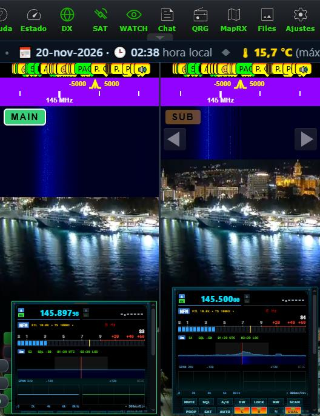

# doble_receptor — Doble receptor MAIN / SUB (EA7CL)

Plugin de receptor para OpenWebRX+, versión **2.1.19**. Se instaló en el servidor `openwebrx` el 20-nov-2026, en **modo enlace**, y se actualizó a la 2.1.19 el 23-nov-2026. Es idéntico al de este repositorio (comprobado con SHA-256). Necesita `rig_skin`, `anti_iframe` **0.2** y `rig_fil_ea7cl` **0.2**; el instalador pone estas dos versiones.



## Qué hace

- Tecla **DUAL** en el panel rig: la pantalla se divide en dos receptores, **MAIN** y **SUB**.
- La cabecera y el letrero del tiempo salen una sola vez y a todo el ancho, como con un solo receptor.
- El MAIN es la página de siempre. El SUB es otra vez la página del receptor, dentro de la otra mitad: un oyente completo, con su panel, su cascada y todos los plugins. Por eso tiene las mismas opciones que el MAIN.
- Los dos receptores usan el **mismo SDR y perfil**: cada uno escucha su frecuencia dentro de la banda.
- Las flechas ◀ ▶ de la cascada («Tune down» / «Tune up») están en los dos receptores.
- En DUAL, cada panel tiene las teclas **L** y **R** (altavoz izquierdo o derecho), **⇆ / ⇅** (columnas o filas) y **DUAL** para salir sin recargar. No tienen rueda, NR, TS, − +, ◀ ▶ ni RIT.
- **Receptor marcado**: con un clic en su cascada, su panel o su letrero (contorno verde para el MAIN, naranja para el SUB). LST, QRG, DX, SAT y WATCH actúan sobre el receptor marcado.
- **Guarda antirrobot**: un DX o SAT fuera de la banda, que movería el SDR común, se frena con un aviso.
- El SUB guarda sus ajustes aparte (volumen, NR, filtros, DSP...).
- Cada DUAL ocupa **2 plazas de oyente**.

## Modos

Los modos solo cambian la línea del plugin en `init.js`. Se aplican al momento, sin reiniciar OpenWebRX; los oyentes lo ven al recargar la página.

| Modo | Qué ve la gente |
|---|---|
| `enlace` (por defecto) | La página normal de siempre, sin tecla DUAL. El DUAL solo sale entrando con `http://servidor:8073/?dual`. |
| `todos` | Tecla DUAL en el panel para todos. |
| `apagado` | Como si no estuviera instalado; el plugin queda guardado. |

En los modos `enlace` y `apagado`, los oyentes normales ni siquiera descargan el plugin. En modo `enlace`, el SUB carga el plugin aunque su dirección no lleve `?dual`, porque se reconoce por su marco (`drx-sub`).

## Archivos

| Archivo | Para qué |
|---|---|
| `doble_receptor.js`, `doble_receptor.css` | El plugin (2.1.19). |
| `scripts/doble_receptor.sh` | `estado` / `aplicar [modo]` / `modo enlace\|todos\|apagado` / `deshacer`. |
| `original/` | `anti_iframe` 0.1 y `rig_fil_ea7cl` 0.1, las versiones de antes, que el instalador reconoce. |
| `../anti_iframe/anti_iframe.js`, `../rig_fil_ea7cl/rig_fil_ea7cl.js` | Las 0.2 que pone el instalador. |

## Instalar, cambiar de modo y desinstalar

```
cd openwebrx-plugins-ea7cl/doble_receptor
bash scripts/doble_receptor.sh estado
sudo bash scripts/doble_receptor.sh aplicar            # modo enlace
sudo bash scripts/doble_receptor.sh modo todos         # o enlace, o apagado
sudo bash scripts/doble_receptor.sh deshacer           # todo como antes de instalar
```

- `aplicar` primero hace una copia de `init.js`, `anti_iframe`, `rig_fil_ea7cl` y, si existiera, del plugin anterior, con sumas SHA-256, en `/var/backups/doble-receptor-2/FECHA/`. Después instala. Si `anti_iframe` o `rig_fil_ea7cl` no son una versión conocida, no toca nada.
- `deshacer` vuelve a la copia de antes de la primera instalación. Comprobado en el servidor: los 156 archivos de `plugins/receiver` quedan idénticos byte a byte.
- No reinicia OpenWebRX. En el navegador: **Ctrl+F5**.
- Con [`copia_owrx`](../copia_owrx/): ejecutar `crear-copia.sh` después de instalar. `actualizar.sh` conserva el plugin y su línea de `init.js` al actualizar OpenWebRX+, porque no son del paquete.
