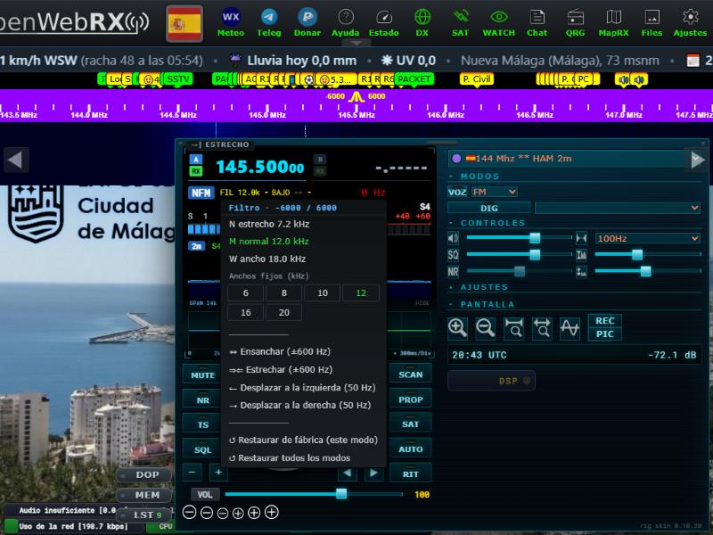
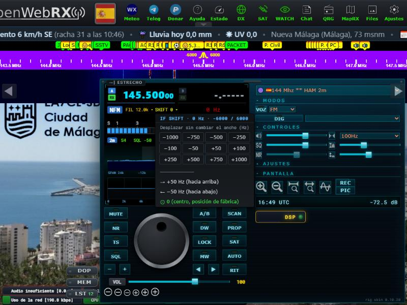

# rig_fil_ea7cl — FIL con anchos fijos e IF SHIFT (EA7CL)

Plugin de receptor para OpenWebRX+, versión **0.5**. Instalado en el servidor `openwebrx` el 23-nov-2026,
idéntico al de este repositorio (comprobado con SHA-256). Necesita `rig_skin`.

## Qué hace

- El letrero **FIL** del panel rig (debajo de la frecuencia) es un botón con desplegable: N / M / W,
  **anchos fijos** del modo (como la tecla FIL/WIDTH de un transceptor), Ensanchar, Estrechar,
  Desplazar ← / →, **Restaurar de fábrica (este modo)** y **Restaurar todos los modos**
  (lo mismo que la tecla `|`, que en teclado español es Ctrl+Alt+1 o AltGr+1).
  - USB/LSB: 1,8 · 2,1 · 2,4 · 2,7 · 3 · 3,3 · 3,6 · 4 kHz (se queda quieto el corte bajo).
  - CW: 100 a 1200 Hz (centrado en el tono). AM/SAM: 3 a 12 kHz. NFM: 6 a 20 kHz.
  - El ancho elegido se guarda para cada modo, igual que al arrastrar el filtro.
- El letrero **SHIFT** (en el sitio que tenía TS) es un **IF SHIFT** como el de un transceptor: mueve el filtro
  entero a un lado y a otro **sin cambiar el ancho**, para dejar fuera una interferencia pegada a un borde.
  **0 = posición de fábrica** del filtro del modo. Botones −1000 … +1000 Hz, ±50 Hz y «0 (centro)».
  - USB/LSB: **+ = más agudo**, **− = más grave** (puede pasar un poco al otro lado de la portadora, como en un equipo real).
  - AM, SAM y NFM: + = hacia arriba en frecuencia. En CW no (el filtro va centrado en el tono: se ajusta con FIL).
  - Los anchos fijos de FIL conservan el SHIFT puesto, y el SHIFT se recuerda por modo.
- El letrero **TS** ya no sale: el panel ya tiene la tecla TS.
- Un **segundo clic** en el letrero (o un clic fuera) cierra el desplegable. Si por debajo no cabe, se abre hacia arriba.
- En modos sin filtro ajustable (DAB, BCFM…) pone «FIL --» y avisa de que el ancho es fijo.
- Banda aérea (118-137 MHz) en AM: ancho normal ±4 kHz.
- Funciona igual en la pantalla normal y en el MAIN y el SUB del doble receptor.





## Archivos

| Archivo | Para qué |
|---|---|
| `rig_fil_ea7cl.js`, `rig_fil_ea7cl.css` | El plugin. |
| `scripts/rig_fil_ea7cl-install.sh` | Instala o actualiza: copia de `init.js` (y del plugin si ya existía), copia el plugin y añade su carga al final de `init.js` si falta. |
| `scripts/rig_fil_ea7cl-uninstall.sh` | Desinstala: quita su línea de `init.js` y aparta la carpeta, con copia de todo. |
| `capturas/` | Cómo se ve. |

En el servidor su línea está justo después de `rig_volumen_ea7cl`; el instalador, si falta, la pone al
final de `init.js`, que también funciona (se carga después de `rig_skin`).

## Instalar o reinstalar

```bash
scp rig_fil_ea7cl/rig_fil_ea7cl.js rig_fil_ea7cl/rig_fil_ea7cl.css rig_fil_ea7cl/scripts/rig_fil_ea7cl-install.sh rig_fil_ea7cl/scripts/rig_fil_ea7cl-uninstall.sh openwebrx:~/
ssh -t openwebrx 'sudo bash ~/rig_fil_ea7cl-install.sh'
```

Después, Ctrl+F5 en el navegador. El servidor deja que cada navegador guarde los plugins hasta una
hora, así que quien ya tuviera la página abierta puede ver la versión anterior durante ese tiempo.

## Desinstalar

```bash
scp rig_fil_ea7cl/scripts/rig_fil_ea7cl-uninstall.sh openwebrx:~/
ssh -t openwebrx 'sudo bash ~/rig_fil_ea7cl-uninstall.sh'
```

No borra nada: guarda `init.js` y la carpeta del plugin en `/home/ea7cl/desinstalado-rig_fil_ea7cl-FECHA`
y al terminar dice la orden para volver a ponerlo.
