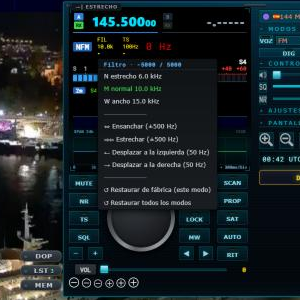

# rig_fil_ea7cl — FIL y TS con desplegable (EA7CL)

Plugin de receptor para OpenWebRX+, versión **0.1**. Instalado en el servidor `openwebrx` el 16-nov-2026,
idéntico al de este repositorio (comprobado con SHA-256). Necesita `rig_skin`.

## Qué hace

- El letrero **FIL** del panel rig (debajo de la frecuencia) es un botón con desplegable: N / M / W,
  Ensanchar, Estrechar, Desplazar ← / →, **Restaurar de fábrica (este modo)** y **Restaurar todos los modos**
  (lo mismo que la tecla `|`, que en teclado español es Ctrl+Alt+1 o AltGr+1).
- El letrero **TS** también: la lista de pasos de sintonía de OpenWebRX.
- Un **segundo clic** en el letrero (o un clic fuera) cierra el desplegable.
- En modos sin filtro ajustable (DAB, BCFM…) pone «FIL --» y avisa de que el ancho es fijo.
- FIL y TS más juntos y la cifra roja (frecuencia del ratón) más pequeña, para que todo quepa en una línea.
- Es el mismo desplegable que el MAIN del doble receptor; si el doble receptor está cargado, este no hace nada.



## Archivos

| Archivo | Para qué |
|---|---|
| `rig_fil_ea7cl.js`, `rig_fil_ea7cl.css` | El plugin. |
| `scripts/rig_fil_ea7cl-install.sh` | Instala o actualiza: copia de `init.js` (y del plugin si ya existía), copia el plugin y añade su carga al final de `init.js` si falta. |
| `scripts/rig_fil_ea7cl-uninstall.sh` | Desinstala: quita su línea de `init.js` y aparta la carpeta, con copia de todo. |
| `capturas/` | Cómo se ve. |

En el servidor su línea está justo después de `rig_volumen_ea7cl`; el instalador, si falta, la pone al
final de `init.js`, que también funciona (se carga después de `rig_skin`).

## Instalar o reinstalar

```bash
scp rig_fil_ea7cl/rig_fil_ea7cl.js rig_fil_ea7cl/rig_fil_ea7cl.css rig_fil_ea7cl/scripts/rig_fil_ea7cl-install.sh rig_fil_ea7cl/scripts/rig_fil_ea7cl-uninstall.sh openwebrx:~/
ssh -t openwebrx 'sudo bash ~/rig_fil_ea7cl-install.sh'
```

Después, Ctrl+F5 en el navegador. El servidor deja que cada navegador guarde los plugins hasta una
hora, así que quien ya tuviera la página abierta puede ver la versión anterior durante ese tiempo.

## Desinstalar

```bash
scp rig_fil_ea7cl/scripts/rig_fil_ea7cl-uninstall.sh openwebrx:~/
ssh -t openwebrx 'sudo bash ~/rig_fil_ea7cl-uninstall.sh'
```

No borra nada: guarda `init.js` y la carpeta del plugin en `/home/ea7cl/desinstalado-rig_fil_ea7cl-FECHA`
y al terminar dice la orden para volver a ponerlo.
